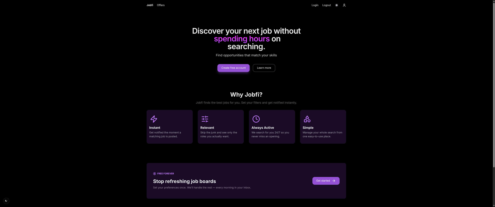
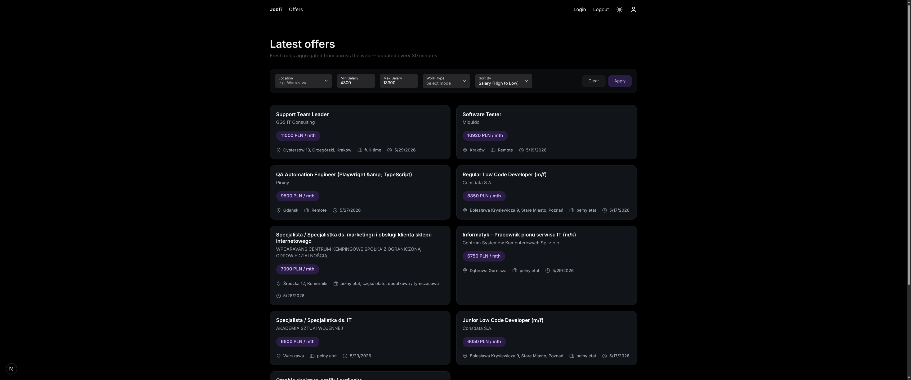
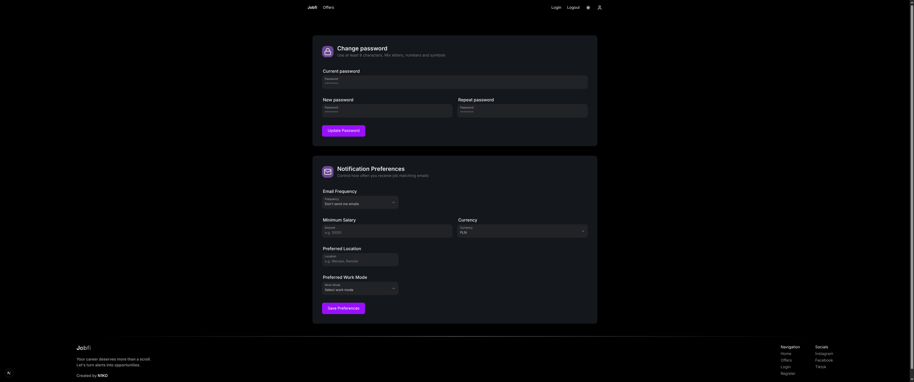

# Jobfi

Jobfi collects IT job offers from six Polish job boards, keeps them in one searchable list and emails you the ones that match your preferences.

Supported boards: JustJoin.it, NoFluffJobs, Pracuj.pl, The Protocol, Bulldogjob and Solid.Jobs.



## Features

- Hourly scraping of all six boards, with each scraper running in isolation so one failing site doesn't stop the others
- Offer browser with keyword search (title, company, tech stack), platform tabs, city, work mode and salary filters
- Salaries normalised to a monthly equivalent, so hourly and daily rates can be filtered and sorted together with monthly ones
- Account with email verification, password reset and JWT authentication
- Notification preferences (minimum salary, city, work mode) with a daily or weekly email digest
- Light and dark theme

| Offers | Profile |
| --- | --- |
|  |  |

## Tech stack

**Frontend:** Next.js 15 (App Router, Server Actions), TypeScript, Tailwind CSS 4, HeroUI, wretch

**Backend:** FastAPI, SQLModel / SQLAlchemy (async), Alembic, APScheduler, Patchright, Brevo for transactional emails

**Infrastructure:** PostgreSQL 17, Docker Compose

## How it works

```
APScheduler (hourly) ──> scrapers ──> PostgreSQL <── FastAPI (/api) <── Next.js server actions
APScheduler (09:00 UTC) ──> match offers with preferences ──> Brevo email digest
```

Each scraper extends `BaseScraper`, which handles salary parsing (ranges, `k` / `tys.` suffixes, hourly, daily and yearly rates), work mode normalisation and deduplication by URL. Scrapers are registered in `backend/app/scrapers/scrapers_manager.py`.

## Getting started

### Docker

```bash
cp .env.example .env
docker compose up --build
```

| Service | URL |
| --- | --- |
| Frontend | http://localhost:3000 |
| API | http://localhost:8080/api |
| API docs | http://localhost:8080/docs |

Migrations run automatically when the backend container starts.

### Without Docker

You need Python 3.13 with [uv](https://docs.astral.sh/uv/), Node.js 22 and a running PostgreSQL instance. Set `DB_HOST=localhost` in `.env`.

Backend:

```bash
cd backend
uv sync
uv run patchright install --with-deps chromium
uv run alembic upgrade head
uv run uvicorn app.main:app --port 8080 --reload
```

Frontend:

```bash
cd frontend
echo "NEXT_PUBLIC_API_URL=http://localhost:8080/api" > .env.local
npm ci
npm run dev
```

### Running scrapers manually

```bash
cd backend
uv run python -m app.scrapers.scrapers_manager --platform NoFluffJobs "Solid.Jobs" --limit 5
```

## Environment variables

| Variable | Description |
| --- | --- |
| `POSTGRES_USER`, `POSTGRES_PASSWORD`, `POSTGRES_DB` | Database credentials |
| `DB_HOST`, `DB_PORT` | Database address (`db` inside Docker) |
| `DATABASE_URL` | Async connection string (`postgresql+asyncpg://...`) |
| `SECRET_KEY`, `ALGORITHM`, `ACCESS_TOKEN_EXPIRE_MINUTES` | JWT settings |
| `NEXT_PUBLIC_API_URL` | Backend URL used by the frontend outside Docker |
| `BREVO_API_KEY` | Brevo key for sending emails |

Without a valid Brevo key, verification and password reset links are printed to the backend logs instead.

## Project structure

```
backend/
  app/
    routers/        API endpoints (auth, offers, preferences)
    services/       business logic, emails, notifications
    repositories/   database queries
    scrapers/       one scraper per job board
    models/         SQLModel tables
  migrations/       Alembic revisions
  templates/emails/ Jinja email templates
frontend/
  app/              pages and server actions (offers, auth, profile, about)
  components/       shared UI and landing page sections
```
